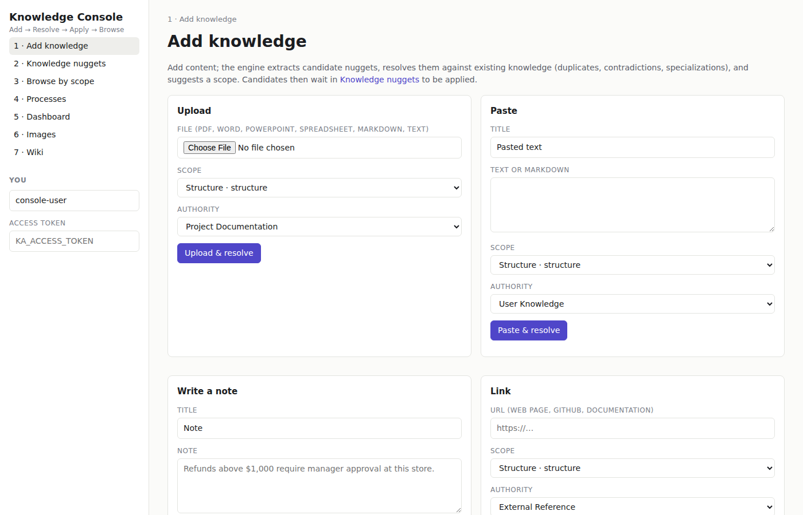
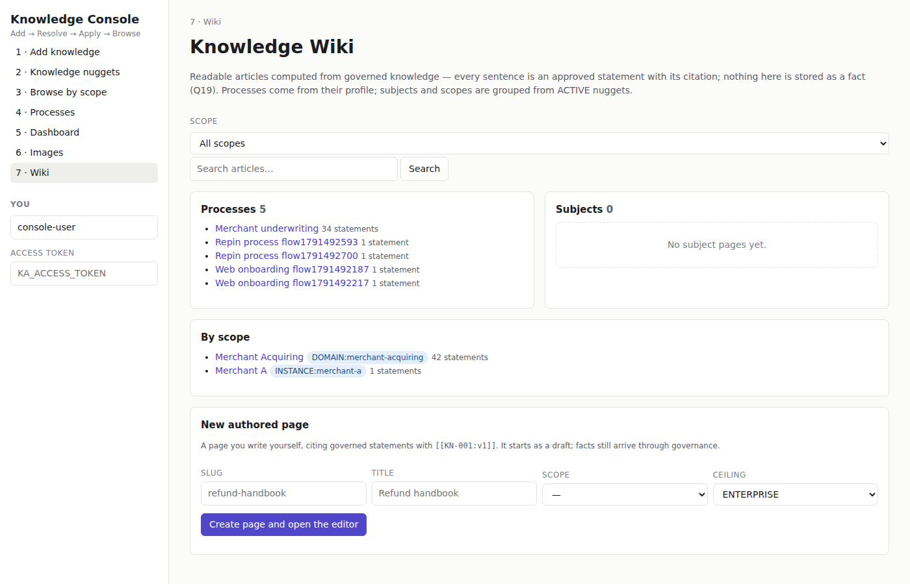
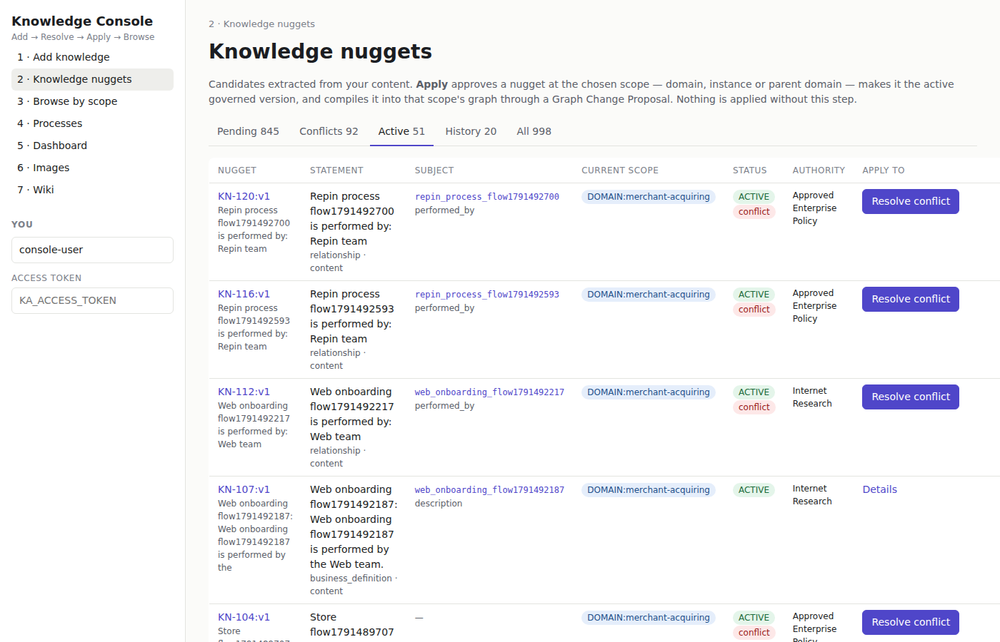
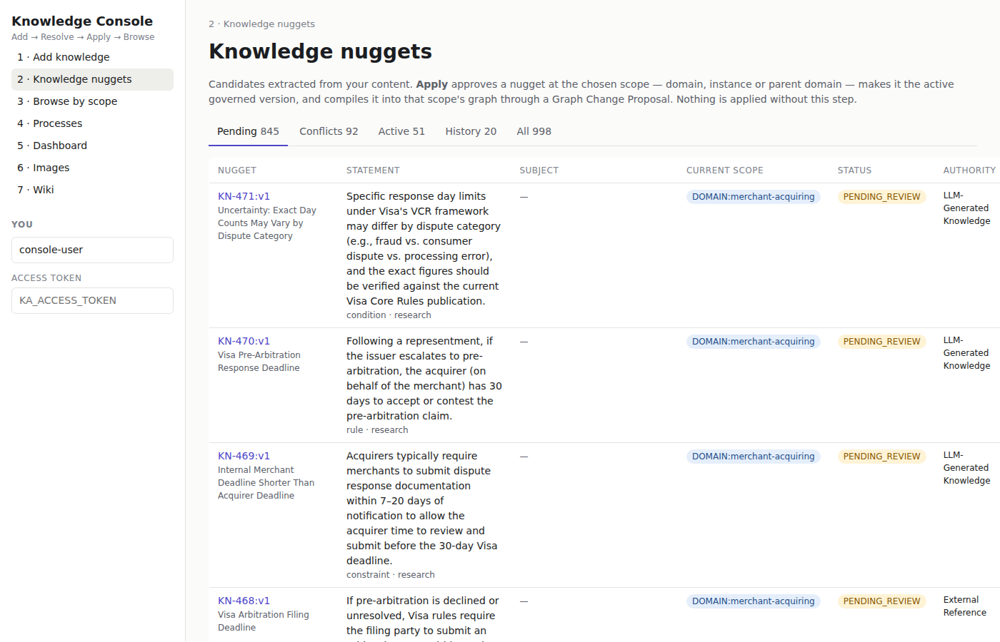

# KA specialist screens — real screenshots (2026-10-11 20:15 UTC)

Taken by `tools/nexos_screenshots.py` from the RUNNING KA (`http://127.0.0.1:8011`) at the paths `GET /v1/screens` returns. These are KA's existing console screens (preserved, not rebuilt); the data shown is the DEV store's real content.

| id | title | path | page heading | JS errors | screenshot |
|---|---|---|---|---|---|
| `ka.sources` | Sources | `/console/#/add` | Add knowledge | 0 |  |
| `ka.research` | Research | `/console/#/add` | Add knowledge | 0 |  |
| `ka.wiki` | Knowledge Wiki | `/console/#/wiki` | Knowledge Wiki | 0 |  |
| `ka.nuggets` | Nuggets | `/console/#/nuggets?view=active` | Knowledge nuggets | 0 |  |
| `ka.reviews` | Reviews | `/console/#/nuggets?view=pending` | Knowledge nuggets | 0 |  |
| `ka.publications` | Publications | `/console/#/nuggets?view=active` | Knowledge nuggets | 0 |  |
